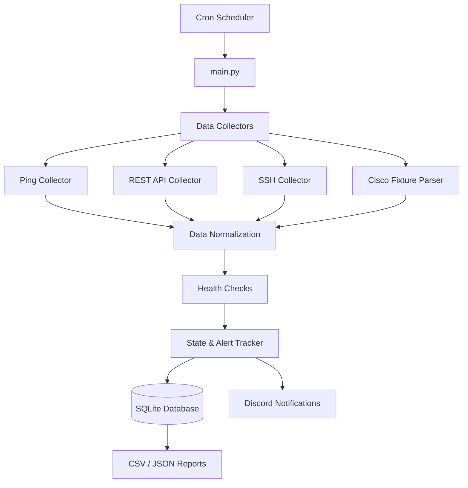

# Network Operations Automation Tool

A Python-based network monitoring and operations automation project designed for NOC and Network Operations practice.

The project collects network and system information, monitors device health, detects abnormal conditions, tracks state changes, sends notifications, and generates operational reports.

## 1. Project Overview

The monitoring workflow follows:

**Collect → Normalize → Monitor → Detect → Alert → Report**

### Key Features

- ICMP Ping monitoring for network reachability.
- REST API collection with API token authentication.
- SSH-based Linux system information collection.
- Cisco IOS CLI output parsing using NTC Templates.
- Device health monitoring and threshold-based detection.
- Alert deduplication and recovery tracking.
- Discord webhook notifications.
- SQLite database for monitoring history and metrics.
- CSV and JSON report generation.
- Scheduled monitoring using Cron.
- Automated testing with Pytest.

## 2. System Architecture



## 3. Technology Stack

| Category | Technologies |
|---|---|
| Programming | Python, Bash |
| Networking | ICMP, TCP/IP, REST API, SSH |
| Network Parsing | NTC Templates, TextFSM |
| API | FastAPI, Requests |
| Database | SQLite |
| Notifications | Discord Webhooks |
| Scheduling | Cron, flock |
| Testing | Pytest |
| Environment | Ubuntu Linux, VMware |

## 4. Project Structure

```text
network-automation/
├── alerts/          # Alert management and notifications
├── api/             # Mock NMS REST API
├── collectors/      # Ping, API and SSH collectors
├── config/          # Device and monitoring configuration
├── data/            # Runtime data and reports
├── fixtures/        # Simulated Cisco CLI outputs
├── monitors/        # Device health checks
├── parsers/         # Cisco CLI output parsing
├── processors/      # Data normalization
├── reports/         # CSV and JSON report generation
├── scripts/         # Monitoring scripts
├── storage/         # SQLite and state tracking
├── tests/           # Automated tests
├── main.py          # Main monitoring orchestrator
├── logging_config.py
├── requirements.txt
├── .env.example
└── README.md
```

## 5. Monitoring Scope

The project combines real local lab connections with simulated network data.

| Component | Implementation |
|---|---|
| Ubuntu SSH | Real SSH connection to the local Ubuntu VM |
| NMS REST API | Simulated FastAPI service |
| Cisco CLI | Simulated Cisco IOS command output fixtures parsed with NTC Templates |
| Ping targets | TEST-NET documentation IP addresses |

Cisco fixtures and the mock NMS API allow monitoring workflows to be tested without connecting to production network devices.

## 6. Installation

Clone the repository:

```bash
git clone https://github.com/NgocTin-himass/network-operations-automation.git
cd network-operations-automation
python3 -m venv .venv
source .venv/bin/activate
pip install -r requirements.txt
cp .env.example .env
```

## 7. Configuration

Configure the following variables in `.env`:

- API authentication token.
- NMS API URL.
- SSH username and private key path.
- Discord webhook URL (optional).

Review monitoring configuration:

`config/devices.yaml`

`config/settings.yaml`

Never commit `.env`, private SSH keys, API tokens, or webhook URLs.

## 8. Running the Project

Start the mock NMS API:

```bash
uvicorn api.mock_nms_api:app --host 127.0.0.1 --port 8000
```

Run a monitoring cycle:

```bash
python main.py --once
```

Scheduled monitoring script:

```bash
scripts/run_monitoring.sh
```

## 9. Testing

Run automated tests:

```bash
pytest -v
```

Tests cover collectors, parsers, health checks, alert management, state tracking, reports, and Discord notifications.

## 10. Security

- Credentials are stored in the local `.env` file.
- `.env` is excluded through `.gitignore`.
- SSH uses key-based authentication in the lab.
- The mock NMS API uses API token authentication.
- Discord webhook URLs must remain private.
- No production network credentials are included.

## 11. Project Objectives

This project demonstrates practical Network Operations concepts:

- Network and system monitoring.
- Troubleshooting and health checks.
- Python-based monitoring automation.
- Alert management and incident visibility.
- Monitoring history and operational reporting.

Developed as a hands-on NOC and Network Operations learning project.
